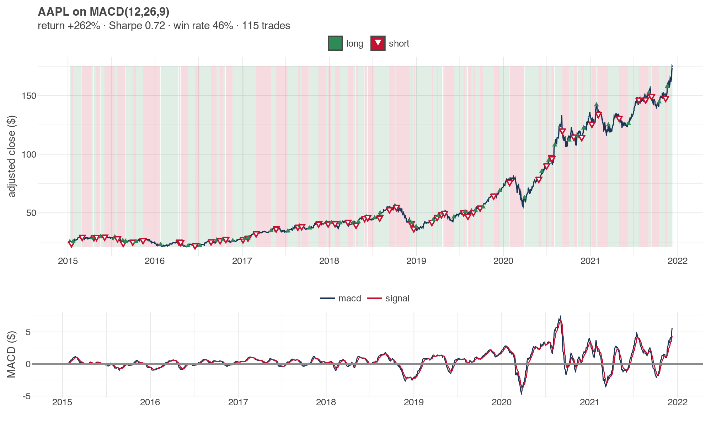

# momentum-signal-scanner

A **momentum-indicator (RSI / MACD) long-short signal scanner**, written as one
teaching notebook. It backtests a universe of stocks against two technical rules,
then ranks every `(ticker, rule)` combination by **risk-adjusted return**, not by
win rate, because, as the results below show, those two can point in opposite
directions.

> **Background:** this scanner is my own clean-room reimplementation of
> momentum / technical-signal research I first explored during a quantitative
> trading internship in 2022. It is built from scratch on public market data,
> with **no proprietary code, data, or strategy**, as a way to re-learn the
> concepts and demonstrate them end to end. See [Background & what I learned](#background--what-i-learned).



## The headline result: why ranking matters

Scanning 8 mega-caps × {RSI, MACD} over 2015 to 2021, after 5 bp costs:

| ticker | rule | total return | **Sharpe** | **win rate** | expectancy |
|--------|------|-------------:|-----------:|-------------:|-----------:|
| AAPL | MACD | **+262%** | **0.72** | 46% | +0.013 |
| TSM  | RSI  | **−57%**  | −0.35 | **88%** | −0.005 |
| MSFT | RSI  | −75% | −0.69 | 75% | −0.062 |

Read those middle two columns. **TSM's RSI rule won 88% of its trades and still
lost 57% of capital**: fifteen small wins and two shorts held for about two years
each into a rising stock (negative *expectancy*). **AAPL's MACD rule won under half
its trades yet returned +262%**, because its winners dwarfed its losers. The
original project ranked by win rate, which would have crowned the 88%-win-rate
*loser*. Ranking by Sharpe + expectancy puts the table the right way up.

## Quickstart

```bash
pip install -r requirements.txt
jupyter lab momentum_signal_scanner.ipynb
```

Run all cells. The notebook reads the cached universe in `data/`, so it works
offline and reproduces the numbers above. To re-pull prices, set `REFRESH = True`
in the setup cell (needs `pip install -U yfinance`).

## What's in the notebook

The structure follows the six stages of a rule from my QF627 course
(price → indicator → signal → detected position → executed position → PnL):

| Section | What it covers |
|---|---|
| 1. Setup | every setting in one cell: universe, dates, costs, indicator parameters |
| 2. The data | load, audit (grain, gaps, missing, unadjusted splits), what the market did |
| 3. Two indicators | RSI (Wilder) and MACD written in pandas, each explained from intuition to formula |
| 4. The six stages | crosses → held position → `shift(1)` → long-short PnL |
| 5. Scoring | Sharpe, drawdown, per-trade win rate and expectancy, buy-and-hold on the same days |
| 6. The scan | 16 books ranked by Sharpe; win-rate ranking vs Sharpe ranking |
| 7. Inside two books | AAPL-MACD (best Sharpe) and TSM-RSI (best win rate), charted |
| 8. What I learned | the three lessons below, with evidence |
| 9. Limitations | in-sample only, flat cost model, survivorship bias |

A rule is one function that turns a price series into a +1 / −1 / 0 position.
The scan loops over a `RULES` dict and never names a rule, so **adding a new rule
is one function and one dict entry, with zero edits elsewhere.**

## Background & what I learned

The idea for this scanner grew out of a quantitative trading internship in 2022,
where I first researched momentum / trend-following strategies built on technical
indicators. **Everything here is my own from-scratch rebuild on public data.** It
reproduces the *method* I learned, not any employer's code, data, or strategy.

**The research process the scanner automates:**

```
define universe  →  compute indicators (RSI / MACD)  →  generate long/short signals
      →  backtest each (ticker × rule)  →  rank by risk-adjusted return  →  shortlist
```

**The three lessons I actually took away:**

1. **The thesis and the data disagreed.** The strategy was *designed* as
   trend-following momentum (buy strength, sell weakness), yet when I grid-searched
   combinations in 2022, the best-ranked results often came from **RSI, a
   mean-reverting, counter-trend indicator.** This rebuild, on a different public
   universe, did *not* reproduce that: MACD holds the top four spots and every RSI
   book has a negative Sharpe. Both results say the same thing: no indicator is
   universally right, and the backtest doesn't have to agree with your story.
2. **RSI alone whipsaws in trends.** It fired counter-trend entries during clean
   trends and bled on them. In this scan, every RSI book's short side lost money
   on all eight tickers. That led to the idea of using **MACD as a trend filter**
   to veto RSI's worst trades (a mean-reverting signal gated by a trend one).
3. **Win rate is not enough** (the lesson this repo is built around): a strategy
   can win most of its trades and still lose money. That's why the scanner ranks by
   **Sharpe and expectancy**, not hit rate. See the headline result above.

## What I changed in the refactor

| Problem in the 2022 version | Fix |
|---|---|
| **Wouldn't run.** `main.py` imported `from strategies`/`from backtester` (wrong names) and built strategies with `asset=None`, crashing on construction | One notebook that runs top to bottom from a cached CSV |
| **Lookahead bias.** Entered a trade at the *same* close that generated the signal | One-bar execution lag: `executed = detected.shift(1)` |
| **Win-rate-only ranking.** Hid losing strategies behind high hit rates | Rank by Sharpe; report expectancy, drawdown and buy-and-hold too |
| **Plotter checked strategy types** with `isinstance(strategy, …)`, so every new strategy meant editing it | Rules are plain functions in one `RULES` dict; the scan never names a rule |
| **Dead on modern libs.** `DataFrame.append` (removed in pandas 2.0); relied on `'Adj Close'` (gone in current yfinance) | Modern pandas; `auto_adjust=True` closes |
| **Not portable.** Hardcoded `/Users/...` output path, TA-Lib C dependency | Repo-relative paths; RSI and MACD written in pandas |

One choice worth knowing: the book compounds **simple** returns, not log returns.
Log returns are fine for a long-flat book, but they overstate every short leg
(a fall from 100 to 50 books +100% for the short instead of +50%), and on this
data that would flip TSM-RSI's expectancy positive.

## Known limitations & biases

- **In-sample, no train/test split.** Parameters are textbook defaults, but
  there's no out-of-sample validation. Read the numbers as descriptive.
- **Simple technical signals mostly lose here.** Over 2015 to 2021 most combos have
  negative Sharpe, and even the best (AAPL MACD, +262%) trails AAPL buy-and-hold
  (about +605%). That's honest, and the point: the value is the *framework and the
  ranking discipline*, not a magic strategy.
- **Flat per-turnover cost model.** No spread/slippage/impact.
- **Survivorship.** The universe is names that did well; a real study needs a
  point-in-time universe including delistings.

## License
MIT. See `LICENSE`.
